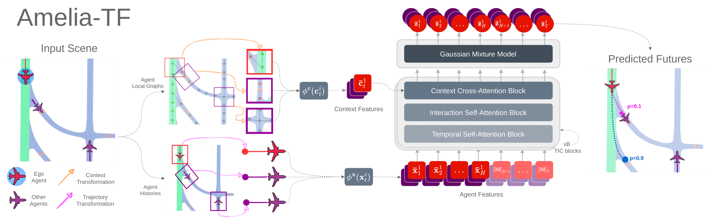

I. Navarro\*, <b>P. Ortega-Kral</b>\*, J. Patrikar\*, H. Wang, Z. Ye, J. H. Park, J. Oh, S. Scherer 
<small>\* Equal contribution</small>

[Paper](https://arxiv.org/abs/2407.21185v1){: .pub-link} [DOI](https://doi.org/10.2514/6.2024-4251){: .pub-link} [Project page](https://ameliacmu.github.io/){: .pub-link} [Code](https://github.com/AmeliaCMU/AmeliaTF){: .pub-link}
{: .pub-links}

Introduces Amelia-48, a public airport surface movement dataset covering 48 US airports, and AmeliaTF, a transformer that forecasts multi-agent trajectories and is evaluated on airports unseen in training.
