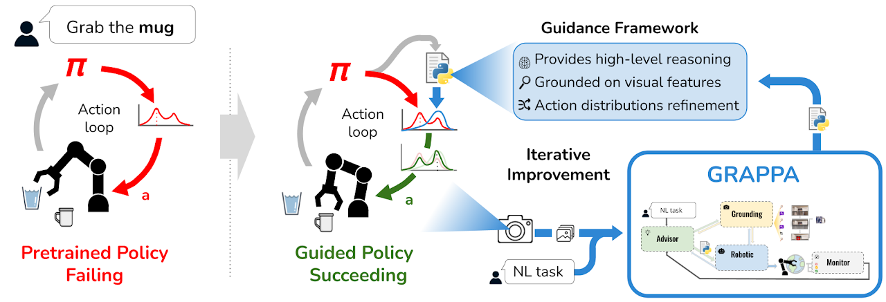

A. Bucker, <b>P. Ortega-Kral</b>, J. Francis, J. Oh

[Paper](https://arxiv.org/abs/2410.06473){: .pub-link} [DOI](https://doi.org/10.1109/LRA.2026.3664527){: .pub-link} [Project page](https://agenticrobots.github.io/){: .pub-link} [Code](https://github.com/project-grappa/grappa){: .pub-link}
{: .pub-links}

A team of role-specialized conversational agents writes guidance functions that steer a pretrained robot policy's actions online. Guidance raises manipulation success in simulation and on real robots without additional demonstrations or retraining.
