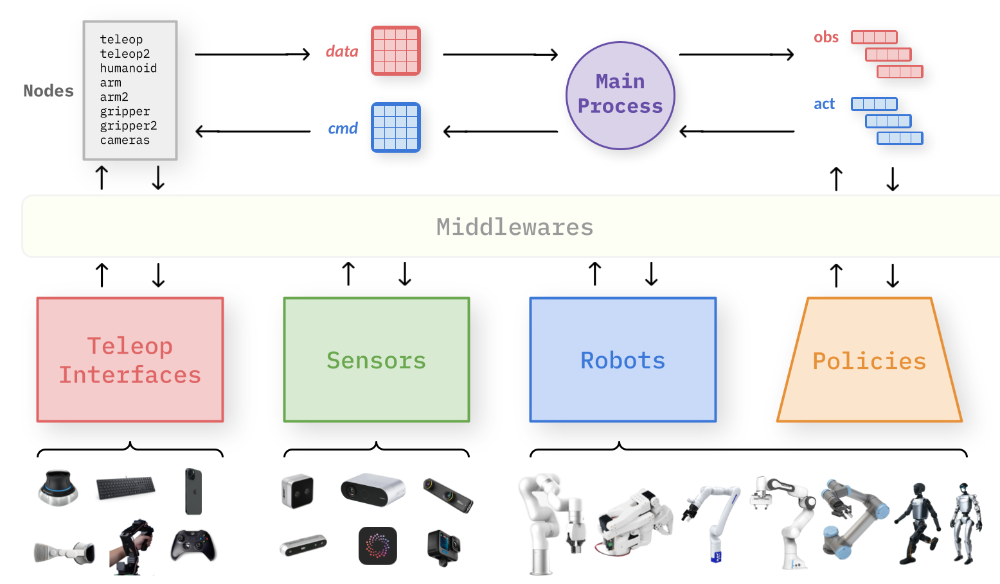

<b>P. Ortega-Kral</b>\*, E. Xing\*, A. Bucker, V. Luk, J. Kim, O. Kwon, A. Xie, N. Sobanbabu, Y. Yuan, M. Lee, D. Ameria, B. Ayapilla, J. Bussell, G. Shi, J. Francis, J. Oh 
<small>\* Equal contribution</small>

[Paper](https://arxiv.org/abs/2605.11564) / [Project page](https://robot-i-o.github.io/) / [Code](https://github.com/robot-i-o/rio)

An open-source Python framework for robot control, teleoperation, data collection, and policy deployment that lets users switch hardware and backends with minimal reconfiguration. It is used to collect data for and deploy VLAs such as π0.5 and GR00T on single-arm, bimanual, and humanoid robots across four hardware platforms.
