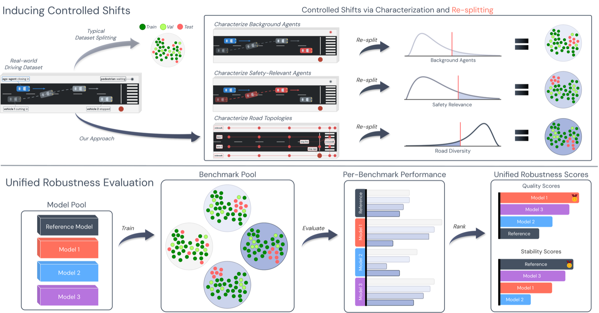

I. Navarro, <b>P. Ortega-Kral</b>, Y. Duan, J. Francis, J. Oh

[Paper](https://arxiv.org/abs/2608.17882){: .pub-link} [Project page](https://navars.xyz/controlledshifts/){: .pub-link}
{: .pub-links}

Introduces a benchmark suite that re-splits existing driving datasets into seen and unseen partitions along three distribution-shift axes, with a unified robustness score that compares trajectory predictors on prediction quality and stability.
